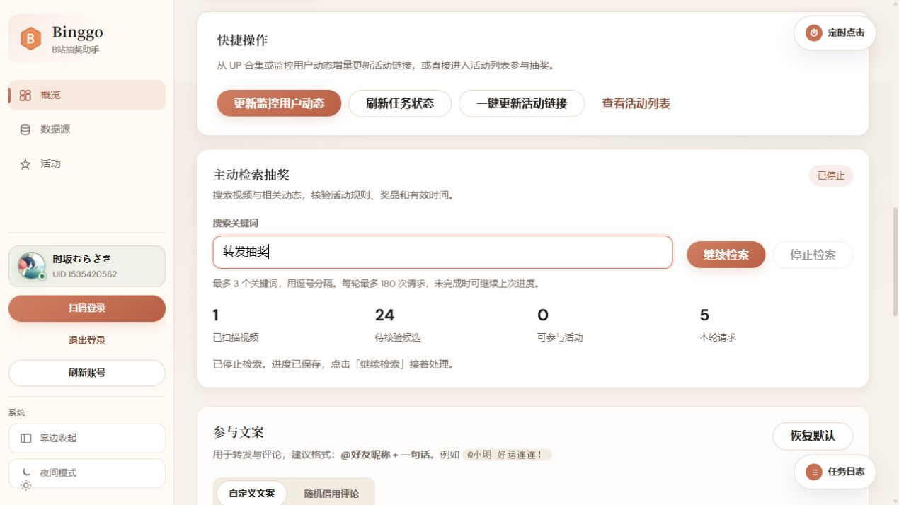

# 主动检索界面入口（修复版 7）

版本：`5.0.5+repostfix.7`，2026-11-22。

概览页的快捷操作下方新增“主动检索抽奖”面板。用户可以输入 1–3 个关键词，开始检索并随时停止；运行期间禁用重复启动。停止或本轮额度耗尽后保存候选与游标，进度有效期内显示“继续检索”。刷新页面仍能恢复任务状态，网页与 MCP 使用同一工作队列。

面板显示已扫描视频、待核验候选、可参与活动和本轮请求次数，并提供已核验动态的链接和奖品名称。每轮上限为 180 次读取请求，预算耗尽显示为暂停，不再误报整次检索完成。此入口执行一轮检索，下一轮由用户点击继续。

停止请求绑定检索任务 ID，不会取消其他参与、刷新或导入任务。等待限速间隔时可立即响应停止；已经发出的网络请求返回后保存进度，不再发送后续平台或模型请求。取消结果保留已有统计与候选。

## 验证

- Python 全量离线回归：558 通过、1 跳过。
- TypeScript 类型检查通过。当前受限环境不能启动 Vite/esbuild 服务进程，使用同版本 esbuild CLI 打包生产资源。
- 构建产物通过 JSDOM 流程验证：开始、停止、结果保留、刷新后继续、额度暂停、停止中禁用重复操作、结果链接与文本安全。
- Playwright 测试脚本已加入；该环境的测试工作进程因 `spawn EPERM` 未能启动，由上述 DOM 测试和实际浏览器操作验证。
- Windows 打包程序的静态资源、检索 API、登录门槛及启动状态检查通过。
- 当前安装版实测：浏览器点击开始、点击停止、刷新页面恢复“已停止”及“继续检索”；共 5 次平台读取、0 次平台写入，停止后计数保持不变。
- 升级前后 6 个原有配置文件 SHA-256 均一致，安装程序与用户数据分开备份，保留回滚记录。

