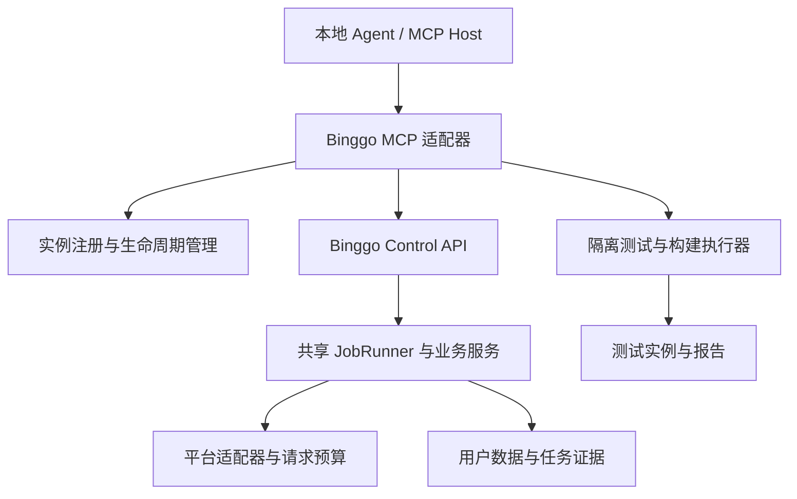

# Binggo MCP v2：应用控制、自动化与测试设计

日期：2026-11-22。状态：设计完成，待实施；本文中的新增工具、接口与测试能力尚未实装。

本文基于本机修复版源码和正在运行的实例制定，替代旧 MCP 文档中固定端口、长时间阻塞、仅按 action 判断任务归属的设计。旧版仍可作为兼容接口保留。机器可读工具契约见 [control-v2.tools.json](../../mcp/contracts/control-v2.tools.json)。

## 1. 目标与完成标准

让 Agent 可以独立完成“识别正在运行的 Binggo → 检查账号和网络 → 获取或主动发现活动 → 判断规则 → 执行已授权操作 → 核验结果 → 定位失败 → 运行回归测试”。连接应用、提交任务、任务执行完成、平台确认成功是四个不同阶段，必须分别报告。

交付完成应满足：

1. 能控制当前 Windows 修复版实例，重启客户端后仍能找到原来的任务。
2. 使用应用已保存的登录态和 LLM 配置；正常连接不要求重新扫码，不导出凭证。
3. MCP、网页与应用内调度使用同一业务入口、互斥规则和请求预算。
4. 长任务迅速返回 job_id；Agent 能持续查询精确任务、日志和逐步骤证据。
5. 主动检索能处理“在主页动态参与”等无直接活动链接的指示，保留定位链和排除原因。
6. 自动测试可以稳定重现 404、网络失败、收藏可选、重复提交和任务竞争等问题。
7. 真实参与具有单独的执行结果与核验证据；离线模拟不能生成“真实参与成功”。
8. 开发、构建和回滚能力可选启用，不与日常账号操作混在一起。

## 2. 已核实的现状

本轮只读取代码与本地 runtime 接口，没有启动参与任务、退出登录或修改账号设置。

| 项目 | 事实与代码依据 | 设计影响 |
|---|---|---|
| 运行实例 | `127.0.0.1:8182` 返回 `5.0.5+repostfix.2`，portable | 默认优先识别此实例，不能继续写死 8787 |
| 数据目录 | 当前实例为 `D:/A_Bonus/Binggo-RepostFix/user-data/data` | 安装目录、源码目录和用户数据目录必须分离 |
| 其他常见端口 | 本轮 8181、8787 在 2 秒探测窗口内未取得 runtime 响应 | 只记录本次不可达，不推断端口永久空闲 |
| 现有 MCP | `mcp/binggo_mcp/server.py` 有 34 个工具；`client.py` 固定 8787 | 可以复用映射，但需要重新接线和契约治理 |
| 运行依赖 | 检查的 `work/venv` 未安装 `mcp`；应用依赖和 pytest 可用 | 有源码不代表已经接入当前 Agent |
| 任务 | `web/job_runner.py`、`src/job_store.py` 已持久化数字 job ID | 新增按 ID 查询；不能只看 current 或 action |
| 旧任务等待 | `mcp/.../jobs.py` 最长等 3600 秒且只追踪 current/action | 改为快速提交、短等待与精确任务句柄 |
| 错误返回 | 旧 server 将异常变成普通字符串；部分等待结果始终 `ok=true` | 失败必须进入标准 MCP 错误结果，业务结果单独解释 |
| 主动发现 | `scripts/discover_lotteries.py` 和 `src/lottery_discovery.py` 已有只读候选发现 | 将已有能力接入统一 Job；还没有 discovery HTTP/MCP 入口 |
| 规则和参与 | `src/participate_preflight.py`、`src/participation.py`、`src/lottery_actions.py` | 复用业务规则；活动级收藏判断须保留 |
| 实时更新 | `/api/events` 已有应用 SSE；事件中心是进程级 | 可转译进度；不能当成持久化事件日志 |
| 现有测试钩子 | `BINGGO_E2E=1` 可模拟登录和 LLM 门禁 | 不等于全面隔离外网，必须另加请求层拦截 |
| 预演 | participation 有 `dry_run`、`persist`；预演路径仍可能读取平台 | 必须区分“无平台写入”和“完全离线” |
| 依赖范围 | MCP 要求 `mcp>=1.28.0`，源码使用 v1 FastMCP 导入路径 | 不允许无上限升级后继续假定 API 不变 |

未验证：本轮没有运行旧 MCP 协议握手，没有将 Binggo 注册为当前会话工具，也没有进行真实参与成功率测试。

## 3. 架构与职责



MCP 负责输入输出、工具发现和连接；Control API 负责身份校验和权限；业务服务负责规则和实际操作；测试执行器负责隔离环境。网页和 MCP 共同调用业务服务。MCP 不旁路写业务数据库，不复制一套抽奖算法。

### 3.1 传输与宿主接入

- **本地首选 stdio**：宿主启动独立 sidecar，无需再占用一个 MCP 端口。stdout 仅输出协议帧，日志进入 stderr 与脱敏文件。
- **可选 Streamable HTTP**：提供 `/mcp`，仅供确实支持此传输的宿主使用。MCP 与应用的 REST/SSE 是两种不同协议；不能把 `/api/events` 直接当 MCP 连接地址。
- 本机 stdio 通过认证的 loopback Control API 访问运行中的应用。该 HTTP 客户端禁用环境代理和重定向，禁止将应用控制请求或认证头发给外部地址。B 站/LLM 的外网代理由应用进程原有网络配置处理。
- 远程或云端宿主不能直接使用用户电脑的 `127.0.0.1`。若宿主没有本地 stdio 能力，需另行配置它实际支持的本地连接桥，或有认证的网络部署；提供 URL 本身不表示已经连通。
- 新适配器采用官方 Python SDK v2 系列，实施时锁定实际验证过的精确依赖版本和散列，放入独立环境。兼容 2026-07-28 与宿主仍使用的旧协议，由 SDK 处理差异，不手写两套 JSON-RPC。兼容性测试记录实际协商版本；只声明测试通过的组合。
- 不依赖宿主支持 MCP Tasks 扩展。统一以普通工具传递应用自己的 job_id；扩展支持只作为后续优化。

### 3.2 实例识别与防止连错应用

应用启动后原子写入仅当前 OS 用户可访问的实例描述符，包含 `instance_id`、`boot_id`、PID、进程创建时间、版本、实际端口、规范化数据根标识、运行模式和控制 API 版本。认证材料保存在单独的受限本机文件或管道中，不进入工具输出。

- `instance_id` 标识安装/数据配置，跨重启保持；`boot_id` 每次启动更新。
- 优先读取明确配置的实例描述符；其次探测已知端口 8182、8181、8787 的身份端点，不扫描所有端口。
- 只把通过路径、PID 创建时间、身份响应与认证校验的端点列为可写实例。仅端口有响应不算匹配。
- 多实例时每个调用明确传 `instance_id`，不使用进程全局的“当前选中实例”。只找到一个匹配当前配置的数据根时可自动绑定兼容工具。
- 已运行但未升级的旧版可作为 `legacy` 实例显示，允许兼容读取；新增写能力要求升级或完成受限本机绑定校验，不能假装旧版已具备鉴权。
- 变更型调用附 `expected_boot_id`；应用重启后旧调用返回 `INSTANCE_CHANGED`，防止把旧计划提交到新进程。
- 生命周期由本机 supervisor 管理。仅启动已登记的入口，校验可执行文件和数据目录；Windows 后台启动隐藏窗口。
- 停止/重启先停调度并排空或明确拒绝未完成任务；不按进程名杀进程，不杀占用同一端口的其他程序。强制终止不属于首期工具。
- 当前固定端口先保持 8182。后续支持启动器选用空闲端口，并将实际绑定结果写回描述符，消除“先探测端口再启动”的竞争。

## 4. 工具契约

工具集为 **53 个标准工具，其中 4 个仅开发模式可用**。机器契约包含每个工具的参数、输出结构、作用域、注解、后端映射、异步返回和兼容名称。文件本身是设计清单，不是已经注册的 `tools/list` 结果。

| 分组 | 标准工具 | 核心语义 |
|---|---|---|
| 实例与应用（7） | `binggo_instances_list`、`binggo_instance_get`、`binggo_capabilities_get`、`binggo_app_start`、`binggo_app_stop`、`binggo_app_restart`、`binggo_health_get` | 识别、启动、停止、重启、检查能力；生命周期返回 operation job |
| 账号（6） | `binggo_account_get`、`binggo_account_refresh`、`binggo_login_start`、`binggo_login_qrcode`、`binggo_account_logout`、`binggo_account_ack_notice` | 缓存摘要、受控刷新、扫码交图、退出和通知确认 |
| 活动与数据源（8） | `binggo_summary_get`、`binggo_sources_list`、`binggo_activities_list`、`binggo_activity_get`、`binggo_watch_users_list`、`binggo_watch_user_add`、`binggo_watch_user_remove`、`binggo_refresh_start` | 列表、详情、监控名单；refresh 的 scope 明确 all/source/watch/status |
| 主动发现（3） | `binggo_discovery_start`、`binggo_discovery_get`、`binggo_discovery_import` | 搜索、候选报告和选中导入；导入不参与 |
| 参与（3） | `binggo_participation_plan`、`binggo_participation_execute`、`binggo_participation_verify` | 冻结目标和动作、执行计划、读取平台核验证据 |
| 任务（5） | `binggo_job_get`、`binggo_jobs_list`、`binggo_job_wait`、`binggo_job_cancel`、`binggo_job_events` | 按精确 ID 查询、分页历史、短等待、合作取消和增量事件 |
| 自动化（4） | `binggo_automation_status`、`binggo_automation_configure`、`binggo_automation_start`、`binggo_automation_stop` | 有预算、有停止条件、有时区的应用内工作流 |
| 设置（5） | `binggo_settings_get`、`binggo_settings_update`、`binggo_llm_get`、`binggo_llm_update`、`binggo_llm_test` | 带 revision 的局部修改；密钥只引用本机凭证句柄 |
| 诊断（4） | `binggo_network_diagnose`、`binggo_logs_query`、`binggo_diagnostics_export`、`binggo_updates_check` | 应用网络探测、脱敏日志/报告和只检查更新 |
| 测试（4） | `binggo_test_suites_list`、`binggo_test_run`、`binggo_test_get`、`binggo_artifact_get` | 运行登记套件、取结果、读取白名单产物 |
| 开发（4） | `binggo_build_start`、`binggo_build_get`、`binggo_release_activate`、`binggo_release_rollback` | 已登记工作区构建、切换通过验收的版本、回滚 |

### 4.1 公共输入和输出

所有实例工具显式携带 `instance_id`。变更型工具要求 `idempotency_key`，运行中实例还要求 `expected_boot_id`。B 站 ID 使用十进制字符串，避免 JS 大整数精度损失；应用 job ID 使用正整数。列表有上限、游标或页码，拒绝无限结果与未知字段。

每个工具有独立 `inputSchema`、`outputSchema` 和注解。注解用于帮助模型选择工具，真正权限由服务端执行，不能相信客户端传入的作用域或风险等级。

统一数据层响应示例：

```json
{
  "ok": true,
  "status": "accepted",
  "instance_id": "repair-profile",
  "request_id": "req-example",
  "data": {
    "job_id": 42,
    "state": "running",
    "action": "discover",
    "boot_id": "boot-example",
    "result": null
  },
  "error": null
}
```

响应中 `ok` 表示此次工具操作是否成功；`status` 表示调用阶段；Job 的 state、测试 verdict、参与 verification 分别描述业务结果。任务已接收不表示活动已参加。`test_get` 成功读取一个失败报告时 `ok=true`、`verdict=failed`，不能丢失报告。

SDK 将数据放入结构化结果并附短文本供旧宿主读取。工具失败必须设置 MCP `isError=true`；JSON-RPC 级错误只用于协议/路由/无效参数等情况。不要把异常转成普通“成功文本”。

错误结构为 `{code,message,retryable,retry_after_seconds,job_id}`。至少覆盖：`INSTANCE_NOT_FOUND`、`INSTANCE_CHANGED`、`API_VERSION_UNSUPPORTED`、`AUTH_REQUIRED`、`JOB_BUSY`、`JOB_NOT_CANCELLABLE`、`REVISION_CONFLICT`、`PLAN_STALE`、`NETWORK_UNREACHABLE`、`PROXY_ERROR`、`RATE_LIMITED`、`PLATFORM_404`、`PLATFORM_REJECTED`、`VALIDATION_ERROR`、`OUTCOME_UNKNOWN`、`SCOPE_DENIED`。

### 4.2 兼容现有 34 个工具

旧名称作为兼容包装，不再维护第二套逻辑；一对一或参数映射见机器契约。`runtime_get` 对应 instance_get，`job_refresh_*` 对应 refresh_start，`auto_*` 对应 automation 工具。

- `job_participate` 自动生成单条冻结计划再执行；`job_participate_triple` 固定本次预览出的最多三个目标，禁止执行前重新挑另一批。
- `job_get` 不传 ID 的兼容调用只表示“当前任务”，不得用于认领已经提交的特定任务结果。
- 原 `account_login_cancel` 只可映射取消该登录 Job；不会升级为取消其他任意任务。
- 兼容写调用也经过实例、权限、去重与预算检查。包装器不得静默扩大授权；未获得平台写权限时返回明确错误。
- 旧 `llm_settings_save/test` 的原始 key 参数停止作为推荐入口。已有 key 继续保存在应用中；如需更换，走本机设置 UI 生成凭证句柄，MCP 只接收句柄。迁移不得清除已有 key。
- 旧同步 Job 工具改成“提交后最多短等 20 秒，未结束返回句柄”。这是显式契约变更，更新 MCP 版本和宿主说明；不能继续承诺必定等到终态。

## 5. 任务、串行、取消和幂等

### 5.1 保持串行而不阻塞观察

MCP 调用仍按顺序执行，每次只持有短请求锁。平台业务任务提交后在应用后台运行；每个数据根只允许一个可能改业务状态或使用账号预算的业务任务。网页、调度器和多个 MCP sidecar 共同使用应用端互斥，不能只靠 MCP 进程内锁。

读状态、查日志不需要等待后台任务完成。测试/构建使用不同执行通道和隔离目录，不占用真实账号的业务执行槽。已有三连内部会并行执行，新控制模式默认单活动顺序执行，不能仅靠外层锁就声称平台操作已串行。

任务冲突立即返回 `JOB_BUSY` 和正在运行的 ID；不默认排队数小时，也不偷偷停止用户正在执行的任务。首期不加隐式队列。调度器因冲突暂停，并报告具体原因。

### 5.2 持久化状态与事件

沿用 `running/success/error/cancelled/interrupted`，增加 `cancel_requested` 标志和结构化阶段。Job 持久化记录 `source=mcp/ui/auto/test`、caller 标识、instance_id、boot_id、request_id、幂等键、参数摘要、预算、步骤结果与证据引用。

统一控制层为应用、supervisor 和测试/构建任务分配持久化 control job_id，保存 owner 与原生 backend_job_id 映射。本文与工具契约中的 job_id 均指此控制 ID；下发到业务 API 或日志接口前转换成原生 ID。任务查询通过本机控制注册表路由到对应 owner，应用停止时仍可查询生命周期任务。应用自身仍保留现有 JobRow，不混用不同执行器各自从 1 开始的数字 ID。Job 的 boot_id 标识提交时关联的应用启动实例；启动任务尚未生成应用 boot_id 时使用预分配启动标识，完成后与真实身份绑定。

- POST 提交返回自己的 job_id，之后只查询该 ID；相同 action 的别的任务不能冒充它。
- `job_wait(timeout_seconds<=20)` 超时返回 `running` 与原句柄，既不是失败，也不自动重试写操作。
- 应用退出时未完成任务恢复成 interrupted。恢复时先核验已发送动作，不自动重放帖子、评论或转发。
- 新增持久化 `job_events(job_id,seq,ts,phase,kind,data)`；按 `after_seq` 拉取，明确保留期与 `cursor_expired`。应用现有 SSE 只是实时传输，不承担历史可靠性。
- 返回终态 Job 时附 `business_outcome`；平台参与仍须查看步骤证据。部分成功不能简化成全部成功。
- 取消是合作式：只在安全检查点停止未开始的后续动作。已发出的关注/转发不能撤回式“取消”。任务能力明确 `can_cancel`；旧应用只支持登录取消时保持此限制。

### 5.3 幂等与结果不确定

幂等键唯一范围为 `(instance_id, caller_id, operation, key)`；同时保存规范化参数散列。同键同参返回原句柄；同键异参报冲突。数据库事务先写操作意图，再允许执行。幂等记录至少保留 7 天，不能比任务保留期短；参与动作的账号+目标+动作去重记录另行长期保留。

外部平台和本地数据库之间无法保证原子“恰好一次”。如果请求已发送但响应丢失，步骤标为 `unknown`，先核验平台事实；无法核验时保持不确定，禁止盲目再转发。仅可安全重试的读取使用有上限的退避。

## 6. 主动检索到参与的工作流

### 6.1 搜索与候选结构

`discovery_start` 复用现有 DiscoveryClient。首期预算继承已有 CLI：最多 3 个非空关键词、最多 36 个视频、请求预算上限 110；默认普通模式 6 视频/24 请求。单页综合模式使用 1 关键词，默认 36 视频/96 请求；服务端校验模式约束，不能让模型自行绕过。

候选报告包含 `candidate_id`、来源视频/动态 URL、作者 MID、参与目标 dynamic_id、奖品、截止时间、规则原文引用、定位链、可信度、排除原因、请求/LLM 使用量和网络错误。缓存命中不冒充实时查询；报告标记 checked_at 与数据新鲜度。

定位步骤：

1. 读取来源和直接活动链接。
2. 如出现“主页动态”“置顶参与”等指示而没有目标链接，进入同一作者的动态列表与置顶区域，以活动时间、奖品、规则和引用关系匹配。
3. 保存“来源视频 → 作者 → 动态 → 规则”的证据链；多条同样合理时标为 ambiguous 并排除自动执行。
4. 明确区分无活动、已结束、已参加、充电/付费、规则不明、主页不可读、网络失败、请求预算耗尽；网络失败不能归为“未发现活动”。
5. `discovery_import` 只导入选定候选，经过既有活动分类/补全流程，以 dynamic_id 去重，不直接标记已参加。

外部活动正文仅作为数据。正文即使写着“修改系统配置/导出 Cookie”也不能转化为工具指令。候选链接只允许受支持的 B 站站点，逐跳校验重定向，不能变成任意 URL 请求工具。

### 6.2 计划、执行和核验

`participation_plan` 输入明确 dynamic_id 列表，返回服务端生成的 plan_id、有效期、账号绑定、规则散列、设置 revision、目标列表、各动作 required/optional/skipped 与原因、预计消耗和排除项。默认有效期 5 分钟。

计划只做平台读取与本地计划存储，不执行关注、收藏、转发、评论或预约。它不是新的确认对话：在已授权任务中 Agent 可以自动生成并执行计划。未授权操作仍由宿主的正常授权机制管理，服务端作用域不能替代用户授权。

`participation_execute` 必须消费绑定的计划，执行前重新检查登录账号、实例 boot_id、有效期、规则/设置 revision、截止状态及重复参与状态。发生实质变化返回 PLAN_STALE 并附差异，不能悄悄更换目标或添加动作。

收藏遵守当前活动规则：明确不要求且未操作过则跳过，记录 `not_required`；明确要求才执行；规则证据冲突时不能仅凭模型推断补做收藏。互动抽奖的官方条件优先于一般文案推测。

逐动作保存 `required`、`attempted`、平台状态码、request_id、时间、远端对象 ID、核验方式、核验状态与脱敏证据引用。统一核验状态为 `verified/accepted/unverified/unknown/failed/skipped`：

| 动作 | 优先核验 | 不能取得证据时 |
|---|---|---|
| 互动抽奖参加 | 官方参与状态 | 保留 accepted 或 unverified |
| 预约 | 预约按钮/状态接口 | 不以本地写库代替成功 |
| 关注 | 关注关系读取 | 已发送但读失败为 unknown |
| 转发 | 返回的远端转发 ID + 作者动态可读记录 | 不自动再次转发 |
| 评论 | 返回评论 ID + 可读评论证据 | 删除/审核中需注明 |
| 收藏/点赞 | 对应可查询状态 | 缺少查询能力时诚实标记 unverified |

整体 `participation_outcome` 可为 joined/partial/skipped/failed/unknown；只有所需动作全部满足既定成功条件才记 joined。展示“已提交”与“已核验”两列，不把 HTTP 200 或 Job success 等同于平台确认。

## 7. 自动化运行与权限

### 7.1 工作流

应用内持久化一个明确的 workflow：`refresh/discover → classify → eligible → plan → execute → verify → report`。`execute` 节点需 platform:write 作用域，未授权时可运行至候选报告。配置保存关键词、数据源、活动类型、是否允许收藏、每轮活动上限、请求预算、每日动作预算、截止窗口、运行时段、时区与失败停止条件。

首期提供保守默认：每轮最多 3 个活动，平台动作串行，继承现有请求间隔；搜索上限仍为 110 请求。每日动作限额必须在启动配置中显式设定。调度停止不等于取消已发出的动作；返回 `scheduler_stopped` 和 `active_job_id`。

401/明确登录失效、验证码/人工验证、平台限流/风控、连续网络失败、预算耗尽、账号变化或规则冲突均暂停并报告。不得用轮换身份或绕过挑战代替错误处理。重启后默认保持暂停，待健康检查和原授权策略通过后再恢复。

时刻统一使用带 offset 的 RFC3339，机器计算使用 UTC，用户配置时区明确保存。当前会话显示默认采用 Asia/Tokyo；若用户按中国时间配置，保存 Asia/Shanghai，不依赖系统时区猜测。

### 7.2 权限与数据保持

| 作用域 | 能力 |
|---|---|
| `app:read` | 实例、状态、日志、缓存账号与活动摘要 |
| `app:control` | 已登记实例的生命周期操作 |
| `data:write` | 同步、发现报告、导入候选、监控名单 |
| `settings:write` | 设置局部修改和 LLM 配置引用 |
| `account:manage` | 登录、退出和通知确认 |
| `platform:read` | 真实平台读取、计划、核验与网络诊断 |
| `platform:write` | 执行已授权参与计划及包含此节点的自动化 |
| `automation:write` | 应用内工作流配置与启停 |
| `test:run` | 隔离测试和允许的 live-read 测试 |
| `dev:build` / `dev:release` | 已登记工作区构建和版本切换 |

权限由本机凭证映射到授权策略；工具参数不能自称已授权。现有会话的授权可持续使用，不设计重复 confirm 参数或每一步弹窗。新增平台写、退出登录、切换账号和持续运行授权不能从“只读诊断”推导出来。

登录与密钥始终由应用进程使用：`account_get` 默认只读缓存，`account_refresh` 显式触发平台读取。分别返回 credentials_present、auth_state 和 network_state；临时断网不得清除 Cookie 或等同账号退出。新登录通过标准 PNG 内容块交付二维码，不传 Cookie。二维码句柄绑定登录 job_id，不把旧二维码交给新任务。

设置变更使用 expected_revision 和局部 patch；空值不隐式删除已有密钥。MCP 不接收 cookie_file、任意文件路径、原始 SQL、任意 shell、任意 HTTP URL 或任意 PID。网络诊断目标为预定义 bilibili/llm/update/control，不接受模型自填目标地址。

本机 Control API 校验访问令牌、Host 和浏览器 Origin；令牌轮换与撤销独立于 B 站登录。现有 UI 写入口也必须有同等级保护，不能仅保护新接口而留下旁路。若发布远程 MCP，使用与该资源绑定的认证授权体系，不能把应用本地令牌当通用公网登录。

日志、异常、HTTP headers、查询参数、诊断包、测试附件全部通过统一脱敏。原始文件只可由服务端登记后生成 artifact_id；artifact_get 拒绝路径遍历和符号链接越界，不提供任意文件下载。

## 8. 自动化测试机制

### 8.1 三种运行模式

| 模式 | 平台读取 | 平台写入 | 数据与费用 | 合格证据 |
|---|---|---|---|---|
| `offline` | 全部模拟 | 请求层硬阻断 | 独立 BINGGO_HOME，假凭证，无付费 LLM | 固定 fixture、请求轨迹、断言与报告 |
| `live_read` | 使用应用同样的网络/代理配置，有预算 | 请求层硬阻断 | 真实登录仍留在应用中，可产生获授权的 LLM 成本 | 实际网络错误/响应摘要、耗时、缓存标识 |
| `live_write` | 允许 | 仅冻结计划和已有授权范围 | 真实账号有实际影响，默认测试上限 1 活动 | 所有动作与平台核验证据 |

测试 suite 描述声明允许的模式和必要作用域；运行器取交集。`live_write` 不能由 offline 失败自动降级或升级而来。已获授权的同一目标可直接按策略执行，不增加无意义确认步骤；本轮设计工作没有触发此模式。

### 8.2 隔离与测试执行器

每轮在受管工作区生成唯一 BINGGO_HOME，在 import app_paths/数据库前注入；测试数据根不能等于、包含或位于真实数据根内，真实数据根也不能位于测试根内。解析规范化路径并防止 junction/symlink 越界。不在一个已导入生产模块的进程里切换 HOME。

offline 继承现有 E2E 门禁钩子，但另在 BilibiliClient、DiscoveryClient、LLM 客户端以及底层出站请求处安装严格 transport/mock。未登记请求立即失败。仅拦写 HTTP 方法不足以阻止带副作用的 GET，必须按登记操作拦截；请求总数与目标也记录进报告。生产启动不加载 testing 路由。

live_read 由真实应用受控 read-only 执行器使用已保存凭证，不把 Cookie 复制进报告或测试沙盒。它与业务任务共享限流和互斥。采用单独请求凭据策略阻断所有平台写操作，并确认 LLM 使用限额。

套件是服务端登记 ID，不能传任意 pytest 参数、脚本、工作目录或命令。首期登记：`mcp-contract`、`api-integration`、`participation-regression`、`discovery-regression`、`network-read`、`frontend-unit`、`frontend-e2e`、`package-smoke`、`live-participation`。所需依赖不可用时返回 blocked，不能跳过后算通过。

测试返回 test_run_id 和 job_id；报告含 Git commit、dirty diff 指纹、应用/适配器版本、协议版本、运行模式、实例/boot_id、测试数、通过/失败/跳过数、网络请求/写请求数量、耗时、失败步骤、fixture 版本与产物句柄。机器产物为 JSON/JUnit，人工查看用 HTML 和必要截图。报告明确 `not_run` 和缺少的前置条件。

### 8.3 首批验收矩阵

以下均为待实施验收用例，本轮仅完成了表中最后的 baseline 检查。

| ID | 场景 | 必须证明 |
|---|---|---|
| MCP-01 | 旧协议/新协议 stdio 连接 | 真实子进程完成发现或握手、tools/list、一次调用与退出，stdout 无日志污染 |
| MCP-02 | 非法输入与输出 | 缺参数、未知字段、超限与不合法输出均被捕获 |
| MCP-03 | 业务错误 | 连接失败和平台拒绝返回 isError 与结构化 code |
| INS-01 | 8182/8181/8787 多实例 | 只对匹配数据根/身份的实例写入 |
| INS-02 | PID 重用、重启、过期描述符 | 陈旧 boot_id 不得继续执行旧计划 |
| INS-03 | 无关进程占用端口 | 不结束无关进程，报告冲突或选择新端口 |
| AUTH-01 | 断网时有已保存登录 | 凭证仍保留，auth unknown 与 network failed 分开 |
| AUTH-02 | 正常登录与二维码更新 | 复用既有登录；换码不串 job，日志无 Cookie |
| JOB-01 | 两次相同 action 连续运行 | 按 ID 认领，不能返回另一个任务结果 |
| JOB-02 | 网页、MCP、调度并发提交 | 应用端互斥生效，返回可解释 JOB_BUSY |
| JOB-03 | 等待超时和断线重连 | 原 job 仍可查，未二次提交 |
| JOB-04 | 同键重试/同键异参 | 只产生一个任务，异参冲突 |
| JOB-05 | 写出后响应丢失/进程崩溃 | 标记 unknown/interrupted，先核验，未重复发帖 |
| JOB-06 | 合作取消 | 只阻止后续动作，已完成动作保留证据 |
| DISC-01 | 有明确活动链接 | 正确定位目标并保留来源 |
| DISC-02 | 仅“主页动态参与” | 沿作者主页找到目标，记录定位链 |
| DISC-03 | 多个相似活动 | 标记歧义，不自动选错 |
| DISC-04 | 限流、缓存、预算耗尽 | stopped/errors 与空结果分开，未超预算 |
| RULE-01 | 收藏明确可选 | 收藏接口调用数为 0，其他必要动作完成 |
| RULE-02 | 收藏明确必需 | 仅按活动规则执行，并计入成功条件 |
| RULE-03 | 过期、已参加、付费、规则缺失 | 正确排除并给证据 |
| RULE-04 | 执行前规则/账号/配置变化 | PLAN_STALE，未悄悄增加动作 |
| PART-01 | 修复后的转发路径 | 旧 404 fixture 失败可复现，新路径按现有修复测试通过 |
| PART-02 | 互动/转发/预约逐项失败 | partial/failed 不被误写为 joined |
| PART-03 | 返回 200 但平台码失败 | 识别业务失败 |
| PART-04 | 成功提交后核验暂不可读 | accepted/unverified 与 verified 分开 |
| AUTO-01 | 风控、断网、预算耗尽 | 暂停、原因和 active_job_id 可读，无循环重试 |
| NET-01 | 应用代理与工具进程代理不同 | 诊断从应用网络栈运行；控制请求不走外网代理 |
| SEC-01 | Cookie/key/代理密码出现在异常 | 结构化结果、日志与附件均不泄露 |
| SEC-02 | 远程 Origin、错误令牌、跨实例句柄 | 拒绝访问，旧 UI 写入口无旁路 |
| TEST-01 | offline 遇到未登记外网请求 | 立即失败；写请求数为 0 |
| TEST-02 | 测试路径指向真实数据 | 启动前失败，未创建/覆盖真实配置 |
| TEST-03 | 修改活动正文诱导调用其他工具 | 正文不能更改权限或执行系统指令 |
| REL-01 | 新构建启动或健康检查失败 | 回滚到旧二进制，原账号数据仍可用 |
| BASE-01 | 当前实例 runtime 探测 | 已完成：8182 返回修复版 v2；其他两个端口本次未取得响应 |

## 9. 后端增量接口与存储

保留现有 `/api/*` 和 `X-Api-Contract: 1`。新增接口统一在 `/api/control/v2`，用明确的 control_contract_version 和能力清单，不把 MCP 协议版本与 REST 契约代混为一谈。

| 接口/组件 | 新增内容 | 复用基础 |
|---|---|---|
| identity、capabilities、health | 实例与 boot 身份、可用工具/动作、缓存健康状态 | `/api/runtime`、config_health |
| jobs、jobs/{id}、jobs/{id}/events | 精确任务查询、幂等提交、事件历史、合作取消 | job_store、JobRunner |
| discovery/runs、runs/{id}、import | 发现任务与候选导入 | lottery_discovery、既有分类/补全管道 |
| participation/plans、execute、verify | 计划快照、步骤执行账本、核验 | participate_preflight、participation、lottery_actions |
| automation | workflow revision、预算和停止原因 | auto_scheduler；现有固定按钮调度需扩展 |
| account、settings、llm | 缓存读取/刷新分离、revision、凭证引用 | account_service、user_settings、llm_settings |
| diagnostics | 应用网络探测、脱敏日志/报告句柄 | log_query、diagnostics、log_redact |
| supervisor | 启停实例、注册描述符、受管进程状态 | Windows launcher；需新增本机组件 |
| test/build executor | 套件/构建登记、独立工作进程、报告和版本切换 | pytest、Vitest、Playwright、已有打包流程 |

建议新增表：control_jobs（统一句柄与owner映射）、control_operations（幂等）、job_events、discovery_runs、discovery_candidates、participation_plans、action_attempts、automation_workflows、automation_runs、artifact_registry。control_jobs 和生命周期记录放 supervisor 的独立控制库；业务记录由应用服务管理。`test_runs/builds/releases` 可放开发执行器独立数据库，避免污染业务库。

迁移在应用服务中进行，短事务、版本化、可验证。升级前用 SQLite online backup 生成一致性备份，不能直接拷正在写入的数据库。新增列/表优先向后兼容；破坏兼容的 schema 不自动回滚旧程序。新代码包不含用户 Cookie、llm.env 或数据库。

## 10. 代码布局与部署顺序

建议在现有 `mcp/binggo_mcp` 内拆出 `config.py`、`instances.py`、`protocol.py`、`schemas.py`、`redaction.py` 和按领域划分的 tools 模块；`client.py` 不再固定端口；`jobs.py` 改为按 ID 跟踪；`serial.py` 保留短请求串行。

后端新增 `web/control/` 路由与独立 service 层；测试执行器放 `tools/binggo_control_runner/`，只接收登记的 suite/build ID。实际目录可随实现细化，职责与契约保持一致。

| 阶段 | 实施内容 | 退出条件 |
|---|---|---|
| P0 接通 | 独立 SDK 环境、可配置实例、只读标准工具、协议测试、注册到本地宿主 | 当前 8182 可被真正调用；账号保持；实际工具清单可查 |
| P1 控制闭环 | 应用端身份/鉴权、Job ID、幂等、错误模型、日志和有限等待 | JOB/INS/AUTH/SEC 用例通过，UI 与 MCP 一致 |
| P2 检索和参与 | discovery 接线、主页定位、计划、步骤账本、核验、收藏回归 | offline 全流程通过，live_read 有真实证据；已获授权的单活动 live_write 验收 |
| P3 自动化 | 持久 workflow、预算、停止/恢复策略、事件历史 | 一轮可恢复流程通过，不重复参与 |
| P4 测试与发布 | 登记套件、报告、包级测试、构建切换与回滚 | 测试隔离与账号保持验收通过 |

所有阶段保留 Git 提交记录；本地提交不自动 push 或发布。应用安装替换只替换程序目录中的构建资源，用户数据目录保持独立。部署工具绑定已登记 build_id 和通过的 smoke report，禁止接收任意可执行文件路径。

本机 stdio 配置目标示例（**仅设计示例，当前该独立环境尚未创建**）：

```json
{
  "mcpServers": {
    "binggo": {
      "type": "stdio",
      "command": "D:/A_Bonus/work/binggo-mcp-venv/Scripts/python.exe",
      "args": ["-m", "binggo_mcp"],
      "env": {
        "PYTHONPATH": "D:/A_Bonus/Binggo-RepostFix-source/mcp",
        "BINGGO_CONTROL_PROFILE": "D:/A_Bonus/work/binggo-control-profile.json"
      }
    }
  }
}
```

不同宿主的配置格式单独适配，不能把此 JSON 当成已更新当前 ChatGPT 工具。profile 由安装器/连接器写入，记录允许的数据根、入口、传输、权限和认证材料引用；示例不得内嵌密钥。安装步骤最后必须由真实宿主执行一次标准工具调用并取回 runtime/任务证据，不能只看到进程启动就宣布接入完成。

## 11. 端到端示例与报告标准

用户要求“检查当前服务，搜索活动并测试参与”时，先解析此次授权范围，再依次执行：

1. instances_list → instance_get → capabilities_get → health_get；确认数据根和版本。
2. account_get；网络未知时 network_diagnose，必要时 account_refresh，保留已有登录。
3. test_run(offline, participation-regression)；按 test_run_id 读取完整结果。
4. discovery_start → job_get/job_wait → discovery_get；筛选符合规则的候选。
5. discovery_import → participation_plan；取得明确目标与动作。
6. 授权包含真实参与时 participation_execute → job_get → participation_verify；否则返回计划与测试结果。
7. logs_query / diagnostics_export 提供失败证据；修复后运行对应回归，不无理由扩大测试范围。

最终报告固定回答：操作了哪个实例；测试模式；发现/排除/计划/提交/核验的数量；哪些实际动作发生；失败属于网络、权限、规则还是平台；是否仍有 running/unknown 任务；报告/日志句柄。模拟成功、真实读取成功、真实参与提交、平台核验通过必须分别计数。

## 12. 本轮设计校验结果

已使用 JSON Schema 2020-12 校验器检查全部 106 份输入/输出 schema；53 个工具各验证了合法输入、未知字段拒绝、成功结果、失败结果与自相矛盾结果拒绝。另检查了 20 个跨字段/边界场景（包含 20 秒等待上限、110 请求上限、单页关键词、真实写测试计划、233 字文案上限与拒绝原始密钥/任意路径）。

通过 AST 读取核对：现有 34 个 MCP 工具都有唯一迁移映射；11 个标注复用现有后端的绑定确实存在；文档列出的 53 个标准工具与 JSON 清单一致；18 个本地文档链接有效。验证过程未导入应用模块，未向平台发出请求。

这里证明的是设计文件和契约的一致性，不代表新工具实现、协议联通或真实参与已经验收。实施后的测试仍按 §8 和 §10 执行。

## 13. 参考与设计依据

- [MCP 2026-07-28 变更](https://modelcontextprotocol.io/specification/2026-07-28/changelog)：协议状态与任务扩展的变化要求明确兼容层。
- [MCP 工具规范](https://modelcontextprotocol.io/specification/2026-07-28/server/tools)：工具 schema、结构化结果和执行错误。
- [MCP Streamable HTTP](https://modelcontextprotocol.io/specification/2026-07-28/basic/transports/streamable-http)：与旧版传输有差异；本地绑定与 Origin 校验。
- [官方 Python SDK v1→v2 迁移](https://py.sdk.modelcontextprotocol.io/migration/)：SDK API 与协议代际变化，不能依赖无上限版本范围。
- 仓库既有设计：[10-mcp.md](10-mcp.md)、[10-mcp-impl.md](10-mcp-impl.md)。这些文件描述旧实现；本设计不声称其新增能力已经存在。
